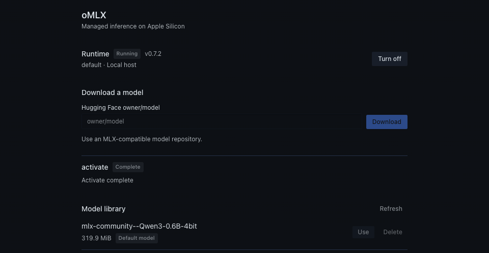

# Verification — 0.1.0

Verified on macOS/Apple Silicon with Hermes 0.23.0. Tests and native operations used isolated data roots, not an operator's model library or active profile.

## Executed

- **30 focused Python tests:** provider discovery remains inert; guarded transport refuses foreign origins/profiles and unowned endpoints; SDK client copies keep the guard; model-path and deletion checks; separate progress channels; profile-scoped jobs; real silent-child cancellation/reaping; the atomic publication cutoff; start/stop during downloads; immediate port reuse after shutdown; and a private native-process HOME.
- **Catalog admission command:** manifest, declared capabilities, real provider registration, dependency preparation, security scan, no-core-override and Desktop SDK-surface checks. The scanner reported `safe`, with no warnings. Its isolation audit correctly identifies the provider's live SDK client as requiring in-process execution.
- **Actual native installation:** fetched the official 0.7.2 DMG (837,764,819 bytes), verified the pinned SHA-256, mounted read-only, copied into the isolated plugin runtime directory and checked the bundled CLI.
- **Actual Hugging Face transfer:** downloaded `mlx-community/Qwen3-0.6B-4bit` through the bundled interpreter. Cancelled the first attempt and verified that the job settled as cancelled and only a hidden partial snapshot remained. Retried successfully: 351,386,061 snapshot bytes, 15,935,477 cached bytes and 326,547,347 newly received bytes. Completion and transport counters are intentionally not interchangeable.
- **Real generation and lifecycle:** the settings UI's Use action started/validated the model and persisted only the isolated profile default. A separate Python process then used the registered provider's guarded client and received a real response beginning `**Ready**.`. This exercises access to the server owned by the backend process, not just same-process mocks. Turn off → immediate Turn on → Turn off also succeeded.
- **Rendered Desktop SDK UI:** loaded the actual plugin module with Hermes's actual SDK, shared React Query client, native components, theme and stylesheet in an isolated development host. Exercised download, cancellation, activation, lifecycle controls and confirmed deletion of a disposable fixture. Running-server deletion was refused; the real downloaded model remained intact. No browser errors were reported.
- **Syntax/lint:** Node parsed the uncompiled ESM; Python syntax and Ruff checks passed.

The screenshot is from that SDK development host, cropped above the absolute local directory path. It is not a screenshot of a plugin enabled in an operator's live Desktop profile.

## Deliberate limits

- No full Hermes regression suite, Windows/Linux runtime test, or benchmark programme.
- No new plugin was enabled in the operator's live profile and no live gateway restart was performed.
- Only public Hugging Face models are supported; no external Hugging Face credentials are read.
- The native provider requires in-process plugin execution. Dashboard operations use polled, buffered job responses and do not require WebSocket support.
- Maintainer acceptance into the catalog is a separate step from local validation and submission.
